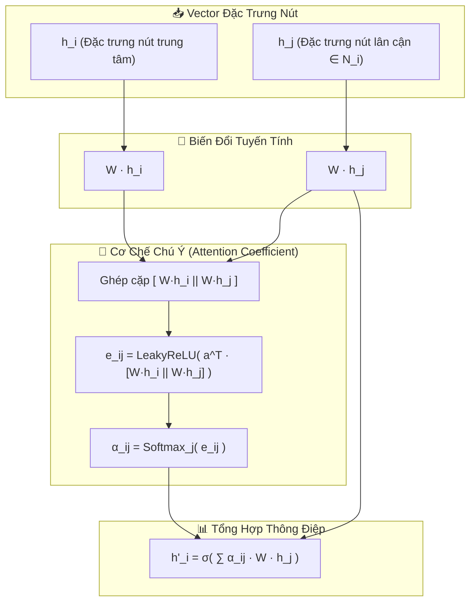

<div align="center">

# 🕸️ GRAPH ATTENTION NETWORKS 🕸️
### 🔬 Deep Learning Research & Implementation of GAT for Classification
*Nghiên Cứu Chuyên Sâu & Hiện Thực Hoá Mạng Chú Ý Đồ Thị (Graph Attention Networks - GAT)*

[](https://python.org)
[](https://pytorch.org/)
[](https://github.com/baolam/graph-attention-classification)
[](https://github.com/baolam/graph-attention-classification)

---

</div>

> [!IMPORTANT]
> **Graph Attention Networks (GAT)** là công trình nghiên cứu và cài đặt chi tiết cơ chế Attention trên cấu trúc đồ thị không đồng nhất. Dự án khám phá khả năng tự động học trọng số tương tác giữa các nút lân cận nhằm nâng cao độ chính xác trong các bài toán phân loại nút và phân loại biểu đồ.

---

## 📑 Mục Lục (Table of Contents)
- [✨ Tính Năng Nổi Bật](#-tính-năng-nổi-bật)
- [🏗️ Cơ Chế Graph Self-Attention](#️-cơ-chế-graph-self-attention)
- [📂 Cấu Trúc Dự Án](#-cấu-trúc-dự-án)
- [⚙️ Công Nghệ Sử Dụng](#️-công-nghệ-sử-dụng)
- [🚀 Hướng Dẫn Cài Đặt & Chạy Nghiên Cứu](#-hướng-dẫn-cài-đặt--chạy-nghiên-cứu)
- [📄 Tài Liệu Nghiên Cứu](#-tài-liệu-nghiên-cứu)
- [📜 Giấy Phép (License)](#-giấy-phép-license)

---

## ✨ Tính Năng Nổi Bật

| Biểu Tượng | Tính Năng | Mô Tả Chi Tiết |
| :---: | :--- | :--- |
| 🧮 | **Cài Đặt Lớp GAT Từ Đầu (From Scratch)** | Hiện thực hóa công thức tính hệ số chú ý $\alpha_{ij}$ sử dụng hàm phi tuyến LeakyReLU và Softmax. |
| 👥 | **Multi-Head Attention** | Mở rộng cơ chế đa đầu chú ý giúp ổn định quá trình học và nắm bắt đa dạng góc độ tương tác cấu trúc. |
| 🔢 | **Thực Nghiệm Phân Loại Chữ Số** | Kịch bản `number_classification.py` đánh giá năng lực của kiến trúc đồ thị trên bài toán phân loại. |
| 🧪 | **Bộ Kiểm Thử Toán Tử Đồ Thị Độc Lập** | Kiểm tra độ đúng đắn của phép toán nút (`test_node.py`) và phép toán đồ thị (`test_graph.py`). |

---

## 🏗️ Cơ Chế Graph Self-Attention



---

## 📂 Cấu Trúc Dự Án

```bash
graph-attention-classification/
├── 📂 GraphAttention/                    # Thư viện triển khai các lớp mạng Graph Attention
├── 📄 number_classification.py          # Kịch bản thực nghiệm huấn luyện và đánh giá mô hình
├── 📄 test_graph.py                     # Unit test cấu trúc đồ thị và liên kết cạnh
├── 📄 test_node.py                      # Unit test thuộc tính và trọng số nút
├── 📄 Nghien cuu ung dung attention vao do thi.docx # Tài liệu báo cáo nghiên cứu chi tiết
└── 📄 README.md                         # Tài liệu hướng dẫn dự án
```

---

## ⚙️ Công Nghệ Sử Dụng

- **Core Deep Learning**: Python 3.9+, PyTorch
- **Graph Processing**: NetworkX, NumPy, SciPy
- **Visualization**: Matplotlib, Seaborn

---

## 🚀 Hướng Dẫn Cài Đặt & Chạy Nghiên Cứu

```bash
# 1. Clone repository
git clone https://github.com/baolam/graph-attention-classification.git
cd graph-attention-classification

# 2. Cài đặt các gói phụ thuộc
pip install torch torchvision networkx numpy matplotlib

# 3. Chạy kiểm thử đơn vị
python test_node.py
python test_graph.py

# 4. Khởi chạy thực nghiệm phân loại
python number_classification.py
```

---

<div align="center">

## 📜 Giấy Phép (License)

Dự án được phân phối dưới giấy phép **MIT License**.

---
**Made with ❤️ by [Bảo Lâm](https://github.com/baolam)**

</div>
